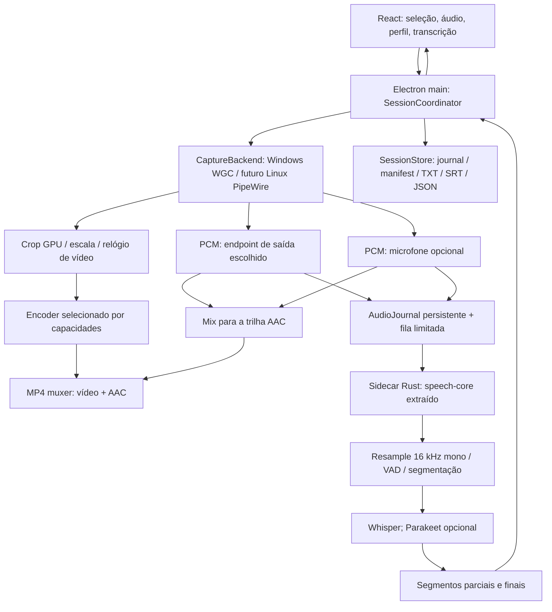
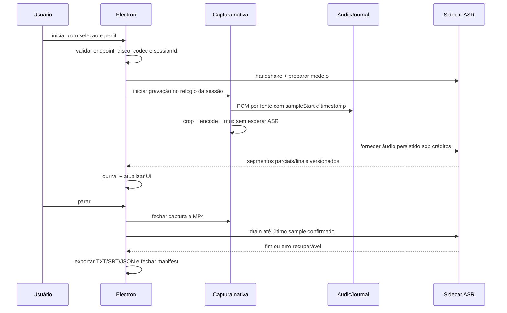

# Arquitetura proposta

**Não é descrição de funcionalidades já integradas.** O estado implementado está
em [STATUS.md](STATUS.md); as decisões estão em [DECISIONS.md](DECISIONS.md).

## Uma aplicação, duas bases

OpenScreen fornece o aplicativo Electron/React, seleção e captura nativa, editor
e exportação. meeting-copilot fornece a referência para pipeline ASR Rust,
normalização/VAD, provedores locais, ciclo de sessão e persistência incremental.
Não executar duas capturas de áudio concorrentes.



## Responsabilidades

| Componente proposto | Dono e contrato |
|---|---|
| UI React | Escolhas, prévia, níveis, progresso; nunca acessa pipe PCM diretamente |
| SessionCoordinator (Electron main) | Um sessionId, estado da sessão, configuração validada, início/fim/recovery |
| CaptureBackend | Único dono da captura; timestamps de origem e contadores de amostras |
| VideoEncoder / muxer | Seleção por capacidades, crop antes do encode, orçamento e MP4 recuperável |
| AudioJournal | Cache local segmentado e manifesto; sinaliza lacunas e limites de disco |
| Speech sidecar | ASR isolado; biblioteca sem dependência de Tauri ou Electron |
| SessionStore | Eventos idempotentes, checkpoints e exportações atômicas derivadas dos finais |

A captura não espera inferência. A persistência de áudio também precisa de fila
limitada: se disco/cache atingir o limite, sinalizar e aplicar uma política explícita
(pausar ASR, manter vídeo, registrar lacuna). "Sem bloquear" não pode significar
memória ilimitada nem perda silenciosa.

## Extração do meeting-copilot

Origem principal: `vendor/meeting-copilot/frontend/src-tauri/src/audio/`.
Primeiro mapear os vínculos com AppHandle, eventos Tauri, estado global, modelos
e persistência. Extrair por testes de contrato, não copiando o aplicativo inteiro.

Estrutura futura, ainda não criada:

```text
crates/speech-core/          áudio normalizado, VAD, segmentador, providers, sessão
crates/speech-sidecar/       processo local e transporte versionado
electron/copilot/           coordenação, cliente IPC e SessionStore
src/components/copilot/     interface integrada
contracts/copilot/          schemas e fixtures interoperáveis TS/Rust
```

O core deve aceitar áudio fornecido por um host: não abre WASAPI nem PipeWire.
Um adaptador Tauri poderá reutilizá-lo depois, mas Tauri não é dependência do
OpenScreenCopilot. O diretório vendor permanece congelado durante a extração.

## Ciclo de execução



Preparar modelo não deve deixar o botão gravar preso: se ASR não estiver pronto,
oferecer gravar com fila/cache ou sem transcrição. Os estados deixam isso visível.

## Estados independentes

Captura: `idle -> preparing -> recording <-> paused -> stopping -> stopped`,
com `failed` recuperável conforme artefatos disponíveis.

ASR: `disabled | loading | running | lagging | draining | completed | failed`.

Sessão final pode estar com vídeo pronto e transcrição pendente; evitar um único
booleano "isRecording" controlando ambos. Cancelar ASR não apaga o MP4.

## Relógios e pausa

Usar relógio monotônico comum da sessão, timestamps capturados no nativo e contadores
de amostras por fonte. Na inicialização registrar a relação entre os relógios nativo
e host. `Date.now()` é apenas metadado de horário civil, nunca base de sincronização.

Manifest mantém intervalos gravados e pausas. Tanto PTS do MP4 quanto tempos SRT
usam a linha de mídia com pausas removidas. Eventos preservam também posição de origem,
para reconstruir a conversão e diagnosticar drift. Resampling deve manter um mapeamento
de amostras de origem, inclusive mudanças de formato/endpoint.

## Persistência e recuperação

```text
<destino>/<sessionId>/
  gravacao.mp4
  transcricao.txt
  transcricao.srt
  transcricao.json
  sessao.json
  recovery/
    events.ndjson
    audio/<source>/<chunkId>.pcm
    audio-index.ndjson
```

Os nomes acima são contrato proposto, não arquivos já emitidos pelo programa.
MP4 usa estratégia recuperável a validar; não prometer recuperação de um MP4
convencional sem trailer. Exportações são escritas em temporários e renomeadas
atomicamente. Journal append-only guarda revisões e checkpoints de áudio confirmado.
Após crash, detectar sessão incompleta e oferecer continuar ASR ou exportar parciais.

Áudio de recuperação só é removido após persistência confirmada das saídas ou escolha
explícita de descarte. Definir política de retenção, limite de disco e limpeza na UI.
Logs técnicos não incluem áudio/texto por padrão.

## Portabilidade

A UI, o core ASR, os contratos e o modelo de sessão são compartilhados.
Windows implementa WGC/D3D11/WASAPI; Linux reutiliza/estende o helper PipeWire e
portais herdados, com crop e endpoints próprios. Validar Wayland/X11, KDE/portal,
VAAPI e pacotes no RegataOS real. Não transportar Win32 para Rust compartilhado.
